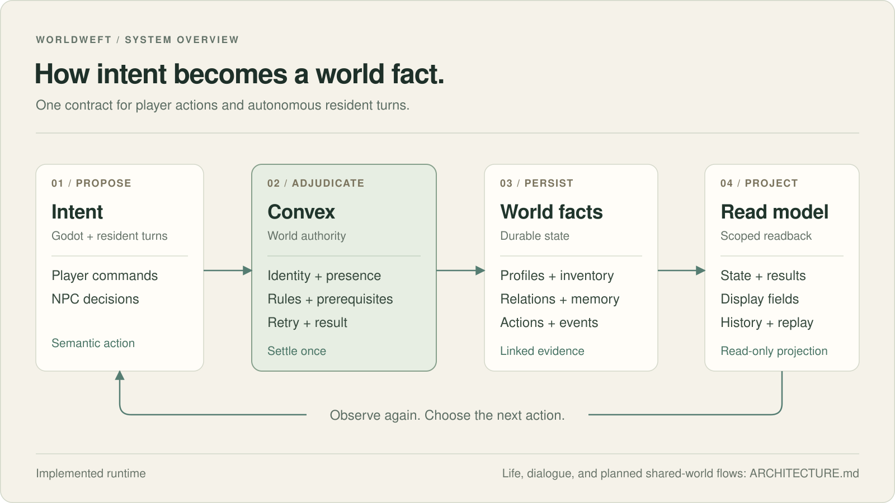

# Worldweft Architecture



## Non-Negotiable Authority Rules

1. **Convex is the durable authority.** It validates requests, applies rules,
   and owns `actionRecords`, `worldEvents`, relationships, memories, and world
   state.
2. **Godot is embodied but non-authoritative.** It owns space, collision,
   input, and presentation. It submits semantic requests and renders returned
   projections.
3. **Agents and LLMs are proposers.** They may supply intent, polish display
   text, or speak dialogue lines. They cannot write durable state or determine
   a canonical outcome.
4. **Every durable outcome has evidence.** A completed action is traceable
   through the action record and any resulting world event.

## Command Lifecycle

```text
Godot or agent intent
        |
        v
Authenticated bridge request
        |
        v
Validate: identity, presence, capability, idempotency, prerequisites, risk
        |
        v
Adjudicate canonical rules
        |
        v
Persist actionRecord, worldEvent, relationship/memory and world-state changes
        |
        v
Build Godot read model and presentation fields
        |
        v
Godot renders the returned projection and replay trace
```

Godot submits requests such as `talk`, `gift`, `trade`, `spar`,
`request_teaching`, `cultivate`, `breakthrough`, `arrive`, and `explore`.
It does not submit an authored outcome. Convex decides whether each request is
legal and records the resulting facts.

## Read And Presentation Model

The bridge returns a rule-owned `summary` together with presentation fields:
`bubbleText`, `displayText`, `bubbleKind`, and `presentationSource`.

This separation is a boundary, not decoration. A future LLM polish layer may
alter optional display language, but cannot rewrite the durable summary,
result code, action record, or world event. The `presentationSource` field
keeps that provenance visible to clients and debuggers.

`/godot/tick` may return a durable event or a `tickOnly` observation. A tick
that does not change durable state must not invent a world event simply to make
the client look active.

## Public Bridge Surface

The authenticated bridge lives in `convex/http.ts` and the `convex/godot*.ts`
modules.

| Endpoint | Responsibility |
| --- | --- |
| `/godot/worldState` | Load world-wide read state. |
| `/godot/regionState` | Load spatial and regional projection data. |
| `/godot/capabilities` | Return currently legal semantic actions. |
| `/godot/action` | Validate, adjudicate, persist, and return an action result. |
| `/godot/tick` | Advance scheduled activity and return durable or tick-only observation. |
| `/godot/actorContext` | Load agent-facing context without granting write authority. |
| `/godot/actionRecord` | Read an authoritative action trace. |
| `/godot/movementGoals` | List movement the runtime wants Godot to walk out. |
| `/godot/movementReport` | Report where a body arrived; Convex decides what the arrival means. |
| `/godot/actionExecutionGoals` | List timed actions the runtime wants Godot to play out. |
| `/godot/actionExecutionReport` | Report a played-out action; Convex settles the result. |

Legacy arrive/interact endpoints are compatibility adapters. They enter the
same formal pipeline and cannot create standalone events.

## Decision And Dialogue Layers

**Per-tick choice is rules-only.** Each tick, every reserved resident runs
`proposeAndAct`: the runtime builds the legal candidates, rules rank them, and
the winner goes through the same action pipeline as a player's request. A
paired A/B against DeepSeek showed no gain from letting a model pick, so the
model is kept out of this loop (`docs/ab-rules-vs-deepseek-2026-10-21.md`).

**Life rules are opt-in.** `humanLifeV1` adds sleep, daily focus, leisure,
gifts and debts, quarrels, grudges, apologies, rumours, and reputation
(`humanLifeLogic.ts`, `humanSocietyLogic.ts`). The offline simulation turns it
on; the live tick does not yet. Changing anything shared must keep the 15
baseline trajectory digests (`npm run life:check-baseline`).

**Dialogue is rule-led.** `playerDialogueLogic.ts` classifies what the player
said, decides whether the resident opens, how many lines they give, when they
leave, what they remember, and how affinity moves (`playerAffinityLogic.ts`).
The model receives a persona card, a fact sheet, and the situation, and writes
one line at a time. It cannot change affinity, memory, or world facts; the
checker in `godot-taixu-client/tools/player_dialogue_checks.mjs` flags lines
that invent people, places, routes, promises, or pasts.

## Reference-World Boundary

The repository includes Qinglan because the bridge needs a real spatial surface
to test location, navigation, capabilities, and resident presence. It is
scaffolding for the runtime, not the public product identity.

The internal `xianxia` and `godot-taixu-client` paths are implementation
residues from that first reference world. They will be replaced with a neutral
example world without changing the authority model. Final maps, sect systems,
economy, art pipelines, and broad content authoring are deliberately outside
this baseline.

## Compatibility Boundary

Some schema and utility modules descend from AI Town. They are backend-only
dependencies retained to keep the baseline executable; they do not reintroduce
the old Web/Pixi client. See [COMPATIBILITY.md](COMPATIBILITY.md) for the
migration boundary.
