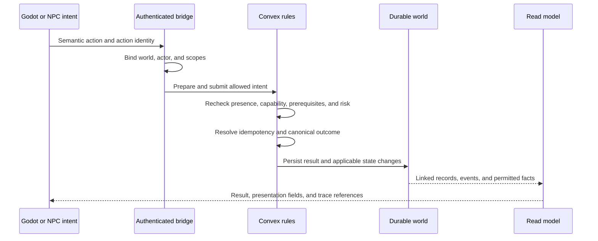
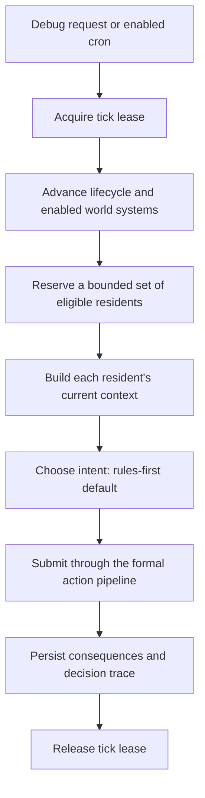
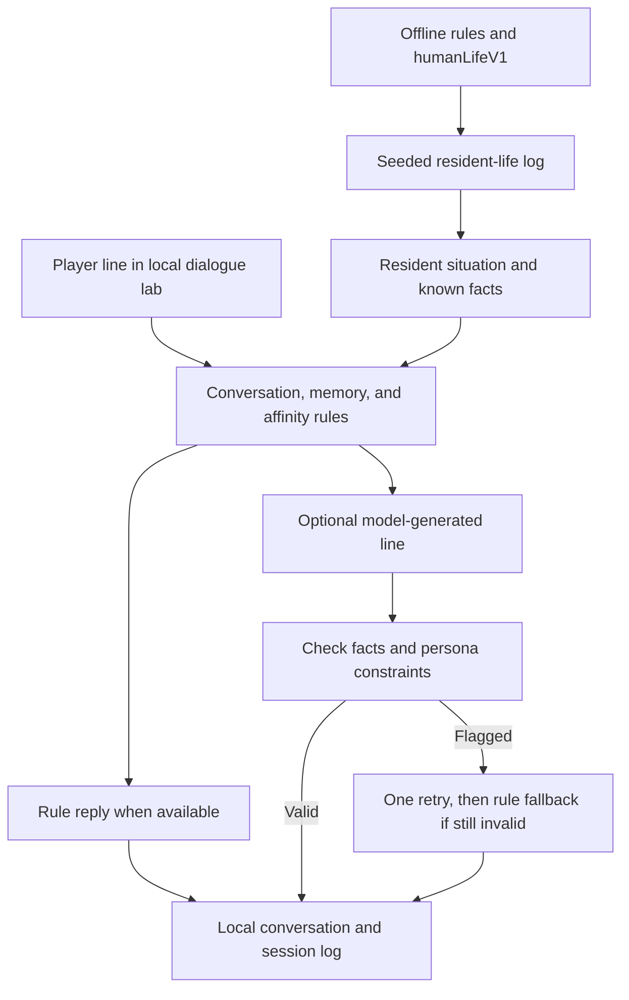
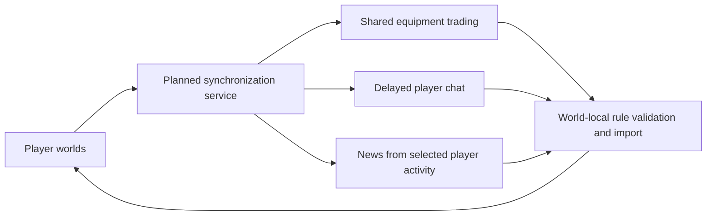

# Architecture

Worldweft separates **intent**, **world consequences**, and **presentation**.
This guide describes the implemented runtime first, the separate life/dialogue
labs next, and the proposed cross-player extension last. Current capability
labels and source evidence are maintained in [Implementation status](docs/STATUS.md).

## System Overview

| Owner | Owns | Boundary |
| --- | --- | --- |
| Godot client | Input, movement, collision, animation, UI | Submits semantic actions and renders read models. |
| NPC decision layer | Observation, candidates, goals, proposed intent | Uses the same formal action pipeline as player intent. |
| Convex rule layer | Validation, adjudication, durable changes | Final authority over what becomes a world fact. |
| Read model and history | Permitted state, result summaries, linked traces | Player visibility is distinct from debug visibility. |
| Optional model | Constrained intent or dialogue text | Model output must pass the relevant rule and validation boundaries. |

A model saying that a gift was given is not an inventory transfer. The formal
`gift` action must be accepted and settled by the world rules. The same
principle applies to relationships, memories, and events.

## Action Lifecycle

1. **Authenticate and bind.** Bridge credentials bind the configured world,
   actor, and scopes; a client cannot select another actor merely by naming it.
2. **Prepare intent.** The bridge reads context and capabilities. Preparation
   is read-only, and does not reserve a successful outcome.
3. **Adjudicate again at settlement.** Final mutation checks use current
   spatial and rule facts, so an earlier preparation cannot authorize a stale
   action.
4. **Persist the outcome.** The result is recorded; accepted actions apply
   their state effects and link the applicable event and history records.
   A rejected request does not receive successful effects.
5. **Return a read model.** The caller receives authoritative results and
   optional display fields, within the viewer's visibility rules.

`clientActionId` identifies a client command across retries. An exact retry
returns its original lifecycle. Reusing a key with different semantics is a
conflict rather than a second application of the action.

The reference action vocabulary includes `talk`, `gift`, `trade`, `spar`,
`request_teaching`, `cultivate`, `breakthrough`, `arrive`, and `explore`.
Domain rules live behind the stable
[`actions.ts`](convex/xianxia/actions.ts) facade and its
[`actionRouter.ts`](convex/xianxia/domains/actionRouter.ts) implementation.

## Autonomous NPC Ticks

The [scheduler](convex/xianxia/agentTickScheduler.ts) uses world/map indexes and
persisted cursors. It scans bounded pages, excludes player-controlled or
ineligible actors, and reserves at most eight residents for a turn. Selection
advances through the population rather than processing every NPC on every tick.

The [tick orchestrator](convex/xianxia/runtime/scheduler/agentTick.ts) advances
lifecycle, social timing, enabled world systems, and selected actors. The
[decision path](convex/xianxia/runtime/decision/proposeAndAct.ts) builds intent
from current context, survival needs, ongoing activity, goals, and candidates.
Ordinary autonomous choice is rule-driven by default. Optional model routes
exist behind deployment and provider-policy gates.

This scheduler is **map-scoped, not player-radius activation**. Switching
nearby residents to model-driven decisions and distant residents to cheaper
routines remains a planned integration. Rules-first turns already reduce the
need for model calls, but they are not proof of that distance-based handoff.

### Runtime Switches

| Switch | Current behavior |
| --- | --- |
| `autoTickEnabled` and `XIANXIA_AUTO_TICK=1` | Both are required for cron-driven turns. Missing world configuration is off; `seedDemo` enables the world switch when creating a new configuration. |
| `autonomousGrowthEnabled` | Separate background growth system; defaults off. |
| `worldDirectorEnabled` | Bounded environment-pressure system; defaults off. The current pressure is herb miasma with resource-refresh effects and expiry. |
| `XIANXIA_AGENT_LLM_ENABLED=1` | Enables an optional autonomous model route; absent means off. |
| Social-model deployment gates | Separate authorization, prompt, budget, concurrency, timeout, and retry controls apply to optional social calls. |
| `humanLifeV1` | Richer resident-life rules used by the offline simulation; not enabled in the live context path. |

See [configuration](convex/xianxia/config.ts),
[scheduler policy](convex/xianxia/agentTickSchedulerPolicy.ts), and
[social-model policy](convex/xianxia/socialModelPolicy.ts) for exact gates.
The world does not automatically keep advancing simply because a client closes;
background progression depends on the configured runtime and enabled ticks.

## Life And Dialogue Labs

The richer life simulation and player dialogue are executable tools with
separate state paths. Connecting them to the live Godot tick is pending.

**Resident life.** `humanLifeV1` adds sleep windows, daily focus, leisure,
outings, social chemistry, gifts, debts, quarrels, apologies, rumours, and
reputation. The simulation is compared against 15 fixed trajectory digests.
The full baseline and CI's five-case quick subset are different checks.

**Conversation.** The local tool reads resident situations from a simulation
log. Rules decide whether a resident opens a conversation, how long they stay,
what they remember, and how affinity changes. A model can supply a line from
that situation and fact sheet. Rules remain responsible for the actual effects.

**Grounding.** Generated lines pass through a checker for invented people,
places, routes, names, promises, and pasts. A flagged line gets one retry; a
second invalid line is replaced with a rule reply. This is a tested heuristic,
not a guarantee that every possible invented statement can be detected.

In dry mode, rule replies still work and model-dependent lines are explicit
placeholders. Local dialogue records are not the live world's durable
relationship or memory tables.

Implementation: [life rules](convex/xianxia/humanLifeLogic.ts),
[society rules](convex/xianxia/humanSocietyLogic.ts),
[dialogue engine](godot-taixu-client/tools/player_dialogue_engine.mjs), and
[line checks](godot-taixu-client/tools/player_dialogue_checks.mjs).

## Read Models And Timed Bodies

Godot receives rule-owned outcomes alongside display fields such as
`bubbleText`, `displayText`, `bubbleKind`, and `presentationSource`. Presentation
can change the wording shown to a player without changing the stored result.

A tick with no durable change returns `tickOnly`. It does not invent a world
event to create the appearance of activity. Player reads are filtered by viewer
policy; unrestricted trace and private actor context belong to authorized debug
surfaces.

Timed-body interfaces let a client fetch movement or action-execution goals,
play them over time, and report completion. Convex decides what those reports
mean. The endpoints exist; consuming them in the reference client is still an
integration milestone.

### Bridge Surfaces

Routes are defined in [`convex/http.ts`](convex/http.ts).

| Method | Endpoint | Purpose |
| --- | --- | --- |
| GET | `/godot` | Public non-secret health and contract summary. |
| GET | `/godot/worldState` | World read model. |
| GET | `/godot/regionState` | Spatial and regional projection. |
| POST | `/godot/capabilities` | Currently legal semantic actions. |
| POST | `/godot/action` | Validate and settle an action. |
| POST | `/godot/tick` | Authorized debug tick advancement. |
| GET | `/godot/actorContext` | Context within the principal's scope. |
| GET | `/godot/actionRecord` | Action trace readback. |
| GET | `/godot/replay` | Read-only history timeline. |
| GET | `/godot/presentationPreview` | Preview presentation from an existing result. |
| GET | `/godot/movementGoals` | Pending movement goals. |
| POST | `/godot/movementReport` | Report body movement for adjudication. |
| GET | `/godot/actionExecutionGoals` | Pending timed actions. |
| POST | `/godot/actionExecutionReport` | Report an action's execution. |

Legacy `/godot/arrive` and `/godot/interact` routes are compatibility adapters
into the formal action pipeline. The health surface also exists at `/`.
Detailed request/response contracts and negative cases are in
[Bridge tests](godot-taixu-client/BRIDGE_TESTS.md).

## Planned Shared-World Extension

The intended multiplayer direction is an asynchronous connection between
primarily single-player worlds. The service below is **proposed**, not part
of the current implementation.

The planned service would collect selected activity, support equipment
exchange, and distribute delayed messages and news. Delivery timing, item
ownership, exchange settlement, and importing shared events into each world
still need implementation and verification.

Current **read-model projections** are views of one configured world's
state. They do not implement this cross-player **projection system**. Local
NPC rumours likewise do not implement a global player news feed.

A complete kingdom simulation, broad hidden-story content, and a general
weather/encounter system are game-level work beyond the current baseline.

## Source Map And Verification

| Concern | Entry point |
| --- | --- |
| HTTP transport and binding | [`http.ts`](convex/http.ts), [`godotBridgeAuth.ts`](convex/godotBridgeAuth.ts) |
| Bridge contracts and read models | [`godot.ts`](convex/godot.ts), [`godotReadModel.ts`](convex/godotReadModel.ts) |
| Action settlement and retry identity | [`actions.ts`](convex/xianxia/actions.ts), [`actionIdempotency.ts`](convex/xianxia/actionIdempotency.ts) |
| NPC turns | [`agent.ts`](convex/xianxia/agent.ts), [`agentTickScheduler.ts`](convex/xianxia/agentTickScheduler.ts) |
| Life simulation | [`purposeBoundLifeSoakLogic.ts`](convex/xianxia/purposeBoundLifeSoakLogic.ts) |
| Local player interaction | [`player_dialogue_engine.mjs`](godot-taixu-client/tools/player_dialogue_engine.mjs) |

[CI](.github/workflows/verify.yml) runs static/unit checks and the life/dialogue
subset. The core local gate adds headless Godot contracts. Connected smoke,
long soaks, and windowed UI evidence are separate steps described in the
[runbook](godot-taixu-client/PRODUCTION_RUNBOOK.md).

Qinglan and the `xianxia` module names come from the initial reference world.
A neutral world pack is planned. Selected AI Town backend modules remain
transitive schema/runtime dependencies; see [Compatibility](COMPATIBILITY.md)
and [Notices](NOTICE.md) before replacing or redistributing them.
