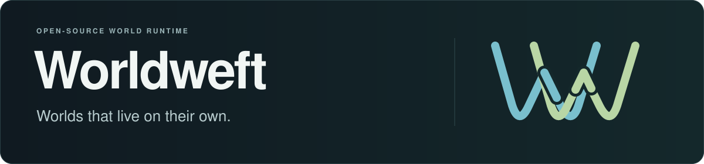
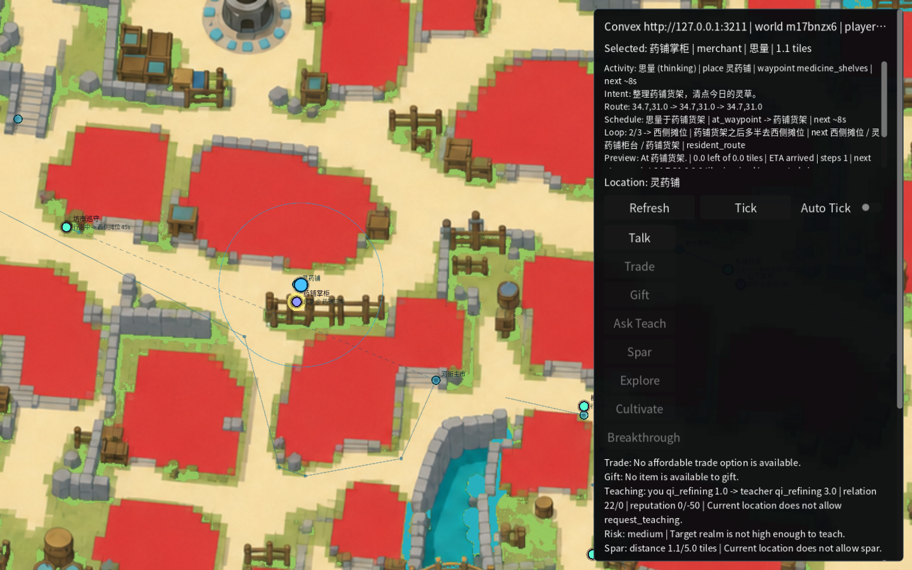
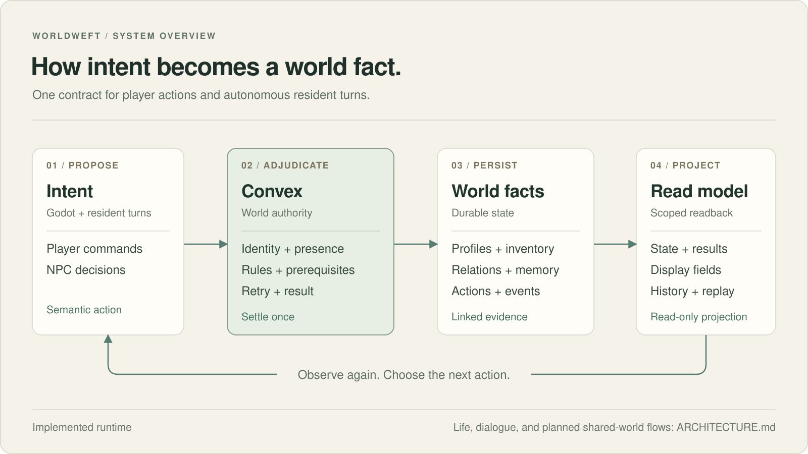

<p align="center">
  
</p>

<p align="center">
  <a href="https://github.com/hX1-dev/worldweft/actions/workflows/verify.yml"></a>
  <a href="LICENSE"></a>
  
  
</p>

<p align="center">
  <a href="#architecture">Architecture</a> &middot;
  <a href="#run-the-core-gate">Quick start</a> &middot;
  <a href="godot-taixu-client/PRODUCTION_RUNBOOK.md">Runbook</a> &middot;
  <a href="CONTRIBUTING.md">Contributing</a>
</p>

Worldweft is an open runtime for persistent, autonomous agent worlds. It pairs
a Godot client for embodied play with a Convex backend for rule adjudication,
durable state, and replayable history. Players, agents, and scheduled systems
may propose actions; only the world runtime can turn those proposals into facts.

This is not an NPC chat wrapper. The simulation continues whether or not a
player is watching, and every real consequence remains inspectable after it
happens.

## At A Glance

| 9 semantic actions | 11 bridge surfaces | 1,593 unit tests | 15 pinned simulations | 2 live viewport gates |
| :---: | :---: | :---: | :---: | :---: |
| Talk through exploration | State, timed bodies, trace readback | Rules, life, dialogue, spatial, replay | Same seeds, same lives | 1024x720 and 1440x900 |

> **Alpha reference implementation.** The authority boundary, semantic action
> pipeline, replay trace, focused test suite, and Godot contracts are
> operational. Qinglan is a real integration fixture, not the final public
> example world.

## System Contract

| Concern | Owner | Non-negotiable rule |
| --- | --- | --- |
| Movement, collision, input, and UI | Godot | Embodies the world but never owns durable facts. |
| Validation, adjudication, and persistence | Convex | The only authority that may create or change world facts. |
| Intent and optional presentation polish | Agent / LLM | May propose; cannot directly write state, events, or records. |
| Evidence and replay | Durable records | Every real outcome is traceable through records and events. |

## Reference Client



The connected debug surface above selects a real resident, loads actor context
and capabilities, advances a tick, and exposes the resulting trace. The Qinglan
fixture makes spatial presence, route preview, semantic actions, and durable
readback testable end to end; it is deliberately not presented as a finished
game or neutral starter world.

## Architecture



- Godot sends a **semantic action**, never a claimed outcome or authored story.
- Convex verifies identity, semantic presence, capability, idempotency,
  prerequisites, and risk before applying canonical rules.
- `actionRecords`, `worldEvents`, relationships, memories, and world state are
  durable rule-owned facts.
- `bubbleText`, `displayText`, and `presentationSource` form a separate
  presentation layer that cannot rewrite those facts.
- A tick without a durable change returns `tickOnly`; it never fabricates a
  `worldEvent` to make the client appear active.

Read the full [architecture](ARCHITECTURE.md) and the durable
[bridge contract](godot-taixu-client/BRIDGE_TESTS.md).

## Run The Core Gate

**Requirements:** Node.js 20-24 and Godot 4.3+. The published baseline is
exercised with Node 24 and Godot 4.7.

```bash
npm ci
GODOT_BIN=/path/to/Godot npm run godot:check-core
```

The gate imports Godot assets, verifies the release-source boundary, typechecks
and lints the bridge, runs the focused unit tests, and validates headless Godot
contracts. A connected session and release evidence are documented in the
[production runbook](godot-taixu-client/PRODUCTION_RUNBOOK.md).

Life and dialogue have their own checks, and none of them call a model:

```bash
npm test                          # every unit test
npm run life:check-baseline       # 15 fixed simulations, about 5 minutes (--quick: s1 only)
npm run dialogue:check-memory     # what residents remember from what you said
npm run dialogue:check-affinity   # how their opinion of you moves
npm run dialogue:chat             # chat window on 127.0.0.1:8766
```

The chat window uses template replies unless `XIANXIA_PI_NPC_DEEPSEEK_API_KEY`
is set in its environment. Keep that key in an environment variable or a local
file; it is never written to logs.

## What Ships Today

- Authenticated world, region, capability, action, tick, actor-context, and
  action-record bridge surfaces.
- Formal conversation, gift, trade, sparring, teaching, cultivation,
  breakthrough, arrival, and exploration actions.
- An inspectable `tick -> action -> event -> actionRecord` lifecycle.
- Capability, semantic-presence, idempotency, risk-confirmation, presentation,
  and tick-only contracts.
- Resident inspection, action selection, event bubbles, route preview, and
  replay/debug tooling in the Godot reference client.
- Timed-body endpoints: a client can pull movement and action-execution goals,
  play them out over time, and report back; Convex still decides what each
  report means. The reference client does not use them yet.
- Rule-driven resident life behind the `humanLifeV1` flag: a sleep window per
  person, a focus for each day, leisure and outings, chat chemistry, gifts and
  debts, quarrels, grudges that fade, apologies, rumours that get garbled when
  retold, and reputations built from what people have heard.
- Player dialogue: rules decide whether a resident talks, for how long, when
  they leave, what they remember about you, and how their opinion of you
  changes. The language model only writes the lines, from the facts the rules
  hand it. Before a line is spoken, a checker looks for invented people,
  places, routes, names, promises, and pasts; the model gets one retry, and a
  rule line replaces it if the retry is still wrong.

## Measured, Not Assumed

Each of these comes from a fixed-seed run or a written standard. The reports are
in Chinese under [`docs/`](docs).

- **Rules choose; the model speaks.** In a paired A/B over three seeds of 3,600
  ticks, DeepSeek picked from the same legal candidates as the rules. Choice
  entropy showed no significant gain (+0.029 bits, 95% CI −0.012 to +0.067),
  the chat rate fell by 13.4 points, and the model only ever reached about 5%
  of world decisions. Per-tick choice therefore stays in the rules
  ([report](docs/ab-rules-vs-deepseek-2026-10-21.md)).
- **Humanity has a score.** A 100-point standard covers individuals,
  relationships, and society, with 14 points reserved for blind human rating
  ([standard](docs/NPC人性过关标准.md)). With rules deciding and DeepSeek
  speaking, the score went from 26 to 78 with the life rules (rules alone: 24
  to 76)
  ([life v1](docs/NPC人性优化_拟人生活v1_2026-10-23.md),
  [conflict, rumour, reputation](docs/NPC人性优化_冲突流言名声_2026-10-23.md)).
  The blind rating has not been done yet.
- **Dialogue has gates.** The [dialogue standard](docs/玩家对话过关标准.md)
  covers persona consistency, human feel, and token cost. Scripted live runs
  scored 85, 80, and 85 out of the automated 85. A conversation averaged about
  341 tokens at full price, meaning prompt-cache misses plus completion.
- **Behaviour is pinned.** `npm run life:check-baseline` reruns 15 fixed
  simulations: rules and life rules, full and memory-only knowledge, 37.5 and
  100 days. It compares each run's trajectory digest, so a refactor that
  changes how residents live shows up as a mismatch.

Life rules run in the offline simulation (`purposeBoundLifeSoakLogic`), and
dialogue runs in a local chat tool on top of that world. Neither is wired into
the live Godot tick yet.

## Repository Map

| Path | Responsibility |
| --- | --- |
| [`convex/`](convex) | Authoritative bridge, rule layer, durable contracts, and tests. |
| [`godot-taixu-client/`](godot-taixu-client) | Godot reference client, presentation, and contract tooling. |
| [`data/`](data) | Reference-world spatial and fixture data. |
| [`docs/`](docs) | Evaluation standards and reports (Chinese): A/B, humanity, dialogue. |
| [`ARCHITECTURE.md`](ARCHITECTURE.md) | Authority model, runtime flow, and public boundary. |
| [`godot-taixu-client/HARDENING_PLAN.md`](godot-taixu-client/HARDENING_PLAN.md) | Reliability and maintainability roadmap. |

## Scope And Roadmap

Worldweft is an infrastructure baseline, not a finished game. Final maps,
economy, broad content authoring, art pipelines, and player progression belong
above this layer.

- **Current:** tested Convex-Godot authority boundary, Qinglan reference world,
  rule-driven resident life, and rule-gated player dialogue.
- **Next:** wire the life rules and dialogue into the live tick and the Godot
  client, a neutral example world, and repeatable public demo capture.
- **Later:** configurable world packs, richer replay tooling, and cleaner
  public package boundaries.

## Project Links

- [Contributing](CONTRIBUTING.md)
- [Security policy](SECURITY.md)
- [Support](SUPPORT.md)
- [Code of conduct](CODE_OF_CONDUCT.md)
- [Compatibility boundary](COMPATIBILITY.md)
- [Positioning and influences](POSITIONING.md)

## Acknowledgements

Worldweft carries forward lessons and selected MIT-licensed code from
[AI Town](https://github.com/a16z-infra/ai-town), while taking inspiration from
the Godot-native multi-agent direction of
[Microverse](https://github.com/KsanaDock/Microverse). See [NOTICE.md](NOTICE.md)
for attribution and fixture-asset notes.

Released under the [MIT License](LICENSE).
