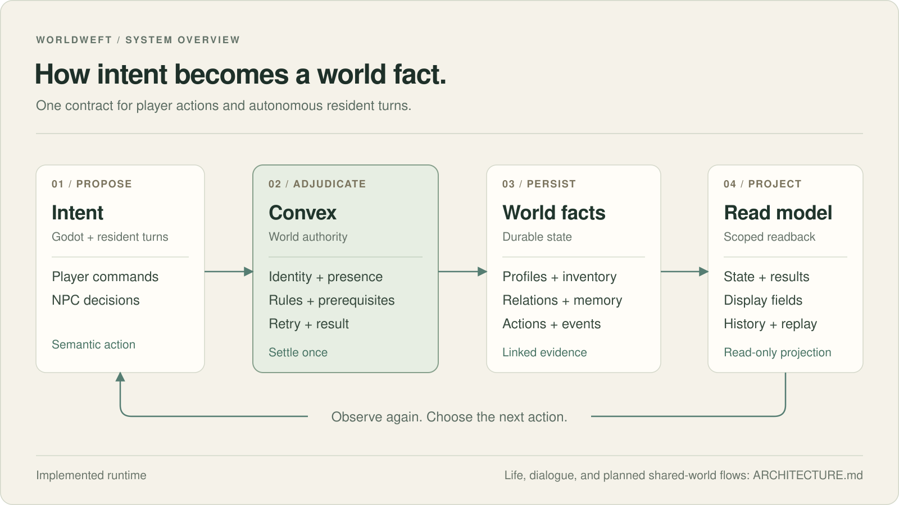

<p align="center">
  
</p>

<p align="center">
  <a href="README.md">English</a> &nbsp;·&nbsp; 简体中文 &nbsp;·&nbsp;
  <a href="docs/README.md">文档目录</a>
</p>

**Worldweft 是基于 Godot 和 Convex 的开源 NPC 世界运行框架。**
它让居民在共同规则中行动，把物品、关系、记忆和事件保存为可以追溯的世界状态。

核心原则是：**Agent 提出意图，世界规则决定结果。** Godot 负责呈现和交互，
Convex 负责校验、结算和保存事实。模型可以参与决策与对话，最终的状态变化由规则执行。

> **目前处于 Alpha 阶段。** Convex 与 Godot 的动作和状态闭环已经实现；
> 更丰富的居民生活运行在离线模拟中，玩家对话运行在独立的本地实验室中。
> 将这些能力接入实时客户端仍是后续工作。
> [实现状态与代码依据](docs/STATUS.md)是判断功能是否已经完成的主要入口。

## 开发实录

https://github.com/user-attachments/assets/dfa4b1da-d848-4f2d-9f14-d53d345a0b3d

视频来自正在开发的修仙模拟器，展示实时运行的 HD-2D 画面与探索。
仓库中的青岚参考客户端用于验证框架的动作、空间规则和历史回读。

## 目前可以使用的部分

| 部分 | 当前范围 |
| --- | --- |
| 世界规则与客户端桥接 | 已实现身份校验、动作结算、状态读取、空间约束和历史回放。 |
| NPC 自主回合 | 已实现按地图限制范围的轮转调度，默认使用规则决策；自动推进需要显式开启。 |
| 居民生活模拟 | 离线实验：睡眠、日常重心、休闲、赠礼、债务、争执、道歉、流言与名声。 |
| 玩家对话 | 本地实验室：性格与事实约束、对话记忆、好感度，以及经过检查的模型回复。 |
| 持续移动与动作执行 | 后端目标和上报接口已有，参考客户端尚未完成接入。 |

玩家附近启用模型、远处切回日常程序，以及跨玩家交易、延迟聊天和共享新闻，
都是希望继续探索的方向。当前仓库尚未实现完整的距离切换或跨世界同步服务。
国家之间的交互和通用随机剧情系统也属于游戏层的后续开发内容。

## 架构



Convex 在这里承担“天道”的规则职责：核对身份、位置、能力和前置条件，
接受合法动作，记录结果，并向客户端提供其有权读取的状态。

例如，NPC 说要送你一件物品，需要通过正式赠礼动作才能改变背包；
一句模型生成的台词本身不能创造装备或直接修改好感度。
重复请求沿用同一个动作标识，避免结果被结算两次。

[详细架构](ARCHITECTURE.md)包含动作生命周期、NPC 调度、对话流程、运行开关，
以及未来异步连接玩家世界的设计。当前各世界之间的信息同步仍在规划中。

## 本地体验

推荐使用 **Node.js 24**，支持范围为 Node 20–24。以下命令可在 PowerShell
或 Bash 中运行。本地对话实验室不需要 Godot、Convex 部署或模型密钥。

```bash
git clone https://github.com/hX1-dev/worldweft.git
cd worldweft
npm ci
npm run dialogue:chat -- --dry
```

终端显示就绪后，打开 **[本地对话页面](http://127.0.0.1:8766)**。首次运行会先生成一份
3,600 回合的规则模拟记录，通常需要约一分钟，期间不会调用模型。

`--dry` 模式可以体验规则回复、记忆和好感度；需要模型生成的台词会显示
`【这句交给 AI】`。如需生成回复，在进程环境中提供
`XIANXIA_PI_NPC_DEEPSEEK_API_KEY`，然后去掉 `--dry` 运行。
使用 **Ctrl+C** 停止实验室。

连接 Godot 参考客户端还需要已初始化的 Convex 部署、参考世界和对应凭证。
完整步骤与 PowerShell 环境变量示例见[上手指南](docs/GETTING_STARTED.md)。

## 验证

[](https://github.com/hX1-dev/worldweft/actions/workflows/verify.yml)

| 命令 | 验证内容 |
| --- | --- |
| `npm run godot:check-core` | 源码边界、类型、lint、soak 策略、单元测试和无窗口 Godot 合约检查。需要 Godot 4.3+，公开基线为 4.7。 |
| `npm run life:check-baseline -- --quick` | 五条固定的 s1 生活模拟轨迹；去掉 `-- --quick` 可运行全部 15 条。 |
| `npm run dialogue:check-memory` | 玩家对话记忆与事实约束。 |
| `npm run dialogue:check-affinity` | 好感度、道歉与对话反应。 |

生活与对话检查不需要模型密钥。CI 在 Linux 和 Windows 上运行源码、静态、
soak 策略和单元检查，在 Linux 上运行生活与对话检查。
连接后端的验证、窗口内画面验收和人工盲评需要单独完成；目前尚未完成人工盲评。

## 下一步

1. 把生活模拟和玩家对话接入实时客户端与权威世界状态。
2. 接入持续移动和动作目标，提供可重复启动的可玩示例。
3. 完善新世界初始化和独立世界包的边界。
4. 验证距离驱动的模型调度，再探索装备交易、延迟消息和共享新闻。

这些是开发方向。具体完成情况以[实现状态](docs/STATUS.md)为准。

## 文档与参与

从[文档目录](docs/README.md)、[上手指南](docs/GETTING_STARTED.md)或
[架构说明](ARCHITECTURE.md)开始。提交改动前请阅读[贡献指南](CONTRIBUTING.md)。
问题讨论可前往 [Discussions](https://github.com/hX1-dev/worldweft/discussions)，
可复现的缺陷请提交到 [Issues](https://github.com/hX1-dev/worldweft/issues)。

Worldweft 基于 [AI Town](https://github.com/a16z-infra/ai-town) 的部分 MIT 许可代码与经验，
也受到 [Microverse](https://github.com/KsanaDock/Microverse) 的 Godot 多 Agent 方向启发。
项目使用 [MIT 许可证](LICENSE)；第三方代码、字体和参考素材说明见 [NOTICE.md](NOTICE.md)。
封面与可编辑架构图的来源见[品牌素材](docs/brand/README.md)，
发行前的剩余工作见[开源发布清单](OPEN_SOURCE_CHECKLIST.md)。
